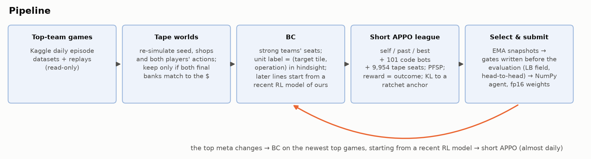

# Kaggriculture: re-clone the top almost daily, then a short RL league

Code, configs, training logs and documentation of team **itwastony (Anton Tikhonov)** in the Kaggle simulation competition
[Kaggriculture](https://www.kaggle.com/competitions/kaggriculture): a two-player farming game with a shared market.
Final place: **8th of 10,148** (final Bradley–Terry leaderboard, score 5395.7; Kaggle API, Oct 16, 2026, 18:24 UTC).
During the competition the team was called "Anton Tikhonov"; that name appears in the episode data and in the code that filters our own games out.



**The agent** is one transformer with 16.3M parameters.
- At every turn it reads the current state and picks a **(target tile, operation)** pair for each unit (up to 16).
- It fills 24 categorical **market heads**.
- A tiny deterministic executor walks units to their targets and assembles the market orders.
- Inference is pure NumPy, greedy, with fp16 weights: about 90 ms per turn on one CPU thread.

**Training** is two steps per "line", repeated almost daily because the top meta kept changing:
1. **Behaviour cloning (BC)** on exact replays of the current top teams' newest games. From the second top-team line
   on, BC starts from a recent RL model of ours.
2. **A short APPO run** in a league of self-play, past versions, 101 code bots and about 10,000 replayed seats of
   recorded games ("tape worlds": recent top-team games, "fast opening" seats and a weak field), with the game
   outcome as the reward.

## Contents

- [Results](#results)
- [Key ideas](#key-ideas)
- [Quick start](#quick-start)
- [Retraining](#retraining)
- [Development](#development)
- [Repository layout](#repository-layout)
- [Documentation](#documentation)
- [What is not in this repository](#what-is-not-in-this-repository)
- [Acknowledgements](#acknowledgements) · [License](#license)

## Results

| | Final submission 1 | Final submission 2 |
|---|---|---|
| Kaggle submission id | **56718362** | 56713726 |
| Archive | `rl_d7b_110.tar.gz` | `rl_d6_250.tar.gz` |
| Model | line d7, run d7b, EMA weights after 110 iterations | line d6, EMA weights after 250 iterations |
| Checkpoint | `final/d7b_ema_00110.pt` | `second/d6_ema_00250.pt` |
| Submitted | Sep 30, 2026 | Sep 30, 2026 |
| Archive sha256 (published copy, [ASSETS.md](ASSETS.md)) | `bef80bb1…d34b0e` | `d89d96eb…0108bc` |

Live games of the two final submissions, by the opponent's leaderboard rank:

| Opponent (leaderboard rank) | `d6_250`: W-D-L (P) | `d7b_110`: W-D-L (P) |
|---|---|---|
| #1–7 | 135-1-250 (0.351) | 211-0-318 (0.399) |
| #9–30 | 372-0-183 (0.670) | 286-0-105 (0.731) |
| #31 and below | 57-0-2 | 44-0-0 |

*Protocol.*
- **Games:** all public games of the two submissions returned by the Kaggle API on Oct 14, 2026. The API lists at
  most the latest 1,000 games per submission.
- **Ranks:** opponent ranks from the leaderboard taken right after the games, on Oct 14.
- **Score:** P = (W + ½D) / N. Matchmaking is adaptive and the two submissions met different opponents, so the two
  columns are not a paired comparison.

In short: we lose most games against the top 7 and win most games against the rest of the gold zone. Offline
evaluation, checkpoint gates and the live rating history are in [docs/evaluation.md](docs/evaluation.md).

## Key ideas

1. **Tape worlds: one format for data, opponents and tests.** A recorded game (seed, shop order, both players'
   actions) is re-simulated in kagsim, a bit-exact C++ engine. It is kept only if both final banks match the record to
   the dollar. The same object serves as BC data, as a league opponent (the other seat replays its record), and as a
   10,454-seat test set. A tape cannot react, so we trust only *paired differences* between two of our agents on the
   same tapes.
2. **Action = (target, operation), labelled in hindsight.** A recorded move step is labelled with the tile and
   operation of the same unit's next non-move action that day. BC learns intentions instead of walking choreography.
3. **The teacher matters most.** Our first BC teacher was the code bot `c3bc`: our modification of a public V54-family
   notebook (tetsu2131's tetsutani/demand-preserving-turn-sale-timing; the same file was in prvsiyan's notebooks) with
   our layers and 58 constants tuned by the cross-entropy method ([agents/README.md](agents/README.md#not-released)).
   Switching BC from `c3bc` to the top teams' games cut non-wins on the 10,454-seat leaderboard field from 2.28% to
   0.01% (paired, greedy, same seats). This is not a clean ablation: the RL recipe changed too.
4. **BC → RL, almost daily.** BC alone collapses in closed-loop play. Re-cloning on top of RL weights first makes the
   model weaker than its parent; a short APPO run recovers and overtakes it (around iteration 60 in the final line).
5. **Stable outcome-reward RL.** Per-component PPO ratios, a detached value tower with a privileged critic, and KL to
   a *ratchet* anchor that is replaced only by a policy that beats it. With an entropy bonus and a KL weight decaying
   towards zero the policy became "lazy": it stopped investing whenever investing was not needed to win. Our fix,
   entropy bonus 0 and a KL floor, delays laziness but does not remove it, so we prefer early EMA snapshots.
6. **If you need a rule, put it in the training environment.** Forcing the 4th land quadrant at inference only
   destroyed a trained policy's farm; the same rule as an environment event during training worked.
7. **Select by paired head-to-head games with gates written down in advance.** Standard errors are computed per seed
   (the two seats of a seed agree in 98–99% of seeds).

Details and the evidence behind each point: [docs/method.md](docs/method.md) and [docs/lessons.md](docs/lessons.md).

## Quick start

All commands run from the repository root (Python 3.11). The engines are compiled locally, so a C++17 compiler
(g++ or clang++) is needed.

```bash
python3.11 -m venv .venv && . .venv/bin/activate
pip install -r requirements.txt
bash scripts/build_engines.sh --check       # kagsim + kagcore, with self-tests (CPU only)
```

Download the release assets (the two submitted archives and the checkpoints, [ASSETS.md](ASSETS.md)) into
`submission/` and `artifacts/checkpoints/`, then:

```bash
# The archives follow from the checkpoints and this code: hashes, identical weights, same program (no games)
python entry_points/verify_submission.py
# Step 6, inference: play the submitted agent in the official engine as Kaggle runs it (2 games against "starter")
python entry_points/predict.py --opp starter --seeds 1
```

- `verify_submission.py` prints `VERIFIED` when both archives pass. The comparison is of programs, not bytes: comments
  were translated from Russian after the competition ([docs/code_map.md](docs/code_map.md#differences-from-the-competition-time-code)).
- `predict.py` prints the outcome, both final banks and the time per agent call of every game. Our agent alone needs
  719 calls × about 90 ms, about 1 CPU-minute, per game.

### Reproduce the selection number

The head-to-head that decided between our two final checkpoints: `d7b_110` against `d6_250`, 512 seeds × 2 seats.

```bash
python entry_points/evaluate.py --a submission/rl_d7b_110.tar.gz --b submission/rl_d6_250.tar.gz \
    --seeds 512 --seed0 98300000
```

- kagsim and both agents are deterministic: P = 0.6211 came out exactly on our x86-64 servers with the pinned NumPy
  ([docs/evaluation.md](docs/evaluation.md#3-gates-of-the-final-checkpoint)). Other CPU architectures were not
  checked (a different BLAS could flip a near-tie argmax).
- **Cost.** Each game calls each of the two networks 719 times. At about 90 ms per call on one thread, that is at
  least ~2 core-minutes per game, about 37 core-hours for the 1,024 games. `evaluate.py` runs one game per process,
  one thread each, on all CPUs by default; `--jobs` sets the number of processes.
- For a quick look, use fewer seeds (e.g. `--seeds 4`, 8 games). P then differs from 0.621 and has a large SE.
- The number is inflated in d7b's favour (d6 snapshots were opponents in the d7 league). It is a reproducibility
  check, not a strength claim.

## Retraining

```bash
# In a fresh environment, torch from the CUDA 13.0 index first, then the rest. The order matters: after a plain
# torch 2.13.0 from PyPI (requirements.txt pins it), pip counts the +cu130 wheel as already installed and skips it.
pip install --index-url https://download.pytorch.org/whl/cu130 torch==2.13.0
pip install -r requirements-train.txt kaggle==2.2.4    # kaggle: tools/rebuild_worlds.py, tools/fetch_league_bots.py
bash scripts/build_engines.sh --gpu --check                            # + the CUDA engine (needs nvcc)
python tools/rebuild_worlds.py                                          # tape worlds from public Kaggle replays
python entry_points/prepare_data.py --repro 50                          # 1. data integrity + replay check
python entry_points/make_bc_data.py --run d7                            # 2. BC demonstrations (CPU, deterministic)
python entry_points/train_bc.py --run d7 --nproc G                      # 3. BC on G GPUs of one node
python entry_points/train_appo.py --run d7 --nnodes N --nproc G --no-pool-src ...  # 4. APPO, N nodes × G GPUs
python entry_points/export_submission.py --run d7 --ckpt runs/d7/appo/ema_00110.pt --name my_d7b_110  # 5. archive
python entry_points/predict.py --archive runs/d7/my_d7b_110.tar.gz                # 6. play it in the official engine
```

- The configs in `configs/` hold every setting of the original run. The number of ranks (GPUs) is a launch argument;
  the config fixes only the per-rank settings.
- BC demonstrations and BC training are deterministic; APPO is not (asynchronous collection), so a rerun gives a
  statistically similar policy.
- The league needs the public notebooks used as opponents: `python tools/fetch_league_bots.py` installs them
  ([agents/README.md](agents/README.md)). Not all 99 can be restored, so use `--league-available-only`, which changes
  the opponent mix. `tools/rebuild_worlds.py` and `tools/fetch_league_bots.py` need a Kaggle API token.

Step-by-step commands, expected outputs and reference curves: [docs/training.md](docs/training.md).
SLURM templates: `scripts/slurm/`.

## Development

```bash
pip install ruff==0.17.1 pytest==9.1.1 numpy==2.4.6
pip install torch==2.13.0 --index-url https://download.pytorch.org/whl/cpu   # optional
ruff check . && ruff format --check . && pytest -q
```

The same commands run in CI ([.github/workflows/ci.yml](.github/workflows/ci.yml)). The tests are fast and offline:
they need neither the compiled engines nor a GPU, and do not play games or read the release assets. Tests that need
torch are skipped when it is not installed. Lint and format settings are in `pyproject.toml`.

## Repository layout

```
README.md, ASSETS.md + ASSETS.sha256, THIRD_PARTY_NOTICES.md, LICENSE (CC BY 4.0)
SETTINGS.json         directories of the entry points (tools/ and harness/ use fixed paths in the repository)
configs/              every setting of the final line: BC data, BC, APPO, league, export
entry_points/         the pipeline: prepare_data → make_bc_data → train_bc → train_appo → export_submission →
                      predict; verify_submission, evaluate
rl/                   the method: action space, encoder, executor, network, BC, APPO, NumPy export
harness/              tape worlds and kagsim game helpers
tools/                episode download, world rebuild and comparison, league-bot download, BC initialisation
engines/kagcore/      C++ encoder/executor on top of kagsim (Python module kagcore)
engines/kagsim_cuda/  host/device engine headers + parity tools
engines/kagrl_cuda/   CUDA engine + encoder + executor for batched GPU self-play
vendor/kagsim/        third-party bit-exact C++ engine (Apache-2.0)
agents/               our two league bots + sources.json, the source list of the other 99 (agents/README.md)
data/pools/           manifests of the 6 tape-world pools of the final run (episode ids, seeds, shops, seats)
logs/                 training logs of the final line (BC, APPO curves)
docs/                 method, training, evaluation, lessons, code map; images and docs/make_figures.py
scripts/              engine build, SLURM templates
```

## Documentation

| Document | What it covers |
|---|---|
| [docs/method.md](docs/method.md) | The game features that shaped the design, observation and action, the network, tape worlds, BC, APPO, the land rule, inference |
| [docs/training.md](docs/training.md) | Every step from data to the submission archive, with commands, expected outputs and reference values |
| [docs/evaluation.md](docs/evaluation.md) | Paired evaluation, checkpoint gates, how the final checkpoint was chosen, live results |
| [docs/lessons.md](docs/lessons.md) | What mattered, what did not work, limitations |
| [docs/code_map.md](docs/code_map.md) | Map of the code, engine parity checks, differences from the competition-time code |
| [data/README.md](data/README.md) | Tape-world format, the pools, how to rebuild them from Kaggle |
| [logs/README.md](logs/README.md) | The training logs and their fields |
| [ASSETS.md](ASSETS.md) | Checkpoints and archives (release assets) with sha256 |

## What is not in this repository

| Item | Why | How to get it |
|---|---|---|
| Tape worlds (5,539 world files, 5,465 distinct episodes) | other teams' recorded actions | `tools/rebuild_worlds.py` downloads the public replays listed in `data/pools/` and re-checks them to the dollar |
| 99 of the 101 league bots | public notebooks of other authors and agents derived from them | [agents/README.md](agents/README.md) lists every bot; `tools/fetch_league_bots.py` downloads the public ones |
| Checkpoints and the submitted archives | size | release assets, [ASSETS.md](ASSETS.md) |
| Snapshot pools of three earlier lines | size | not published; `--no-pool-src` trains without them (a different mix of past opponents) |

## Acknowledgements

- **Engine.** destbreso's [kaggriculture-cppsim](https://github.com/destbreso/kaggriculture-cppsim) (kagsim), built on
  nikital7's C++ port of the engine ("4000x environment speedup" notebook).
- **Data.** Kaggle's daily top-episode datasets and the public episode replays; the public episodes dataset by
  georgymamarin.
- **Opponents.** The authors of the public notebooks we used as league opponents (agents/README.md).
- **Teachers.** The top teams whose games we cloned. Their new versions kept us busy until the last day.

## License

© 2026 Anton Tikhonov (itwastony). Our code, weights and documentation: [Creative Commons Attribution 4.0 International](LICENSE), as required by the
competition rules for winning solutions. Third-party files keep their own licenses ([THIRD_PARTY_NOTICES.md](THIRD_PARTY_NOTICES.md)):
`vendor/kagsim/` and the files derived from it are Apache-2.0.
