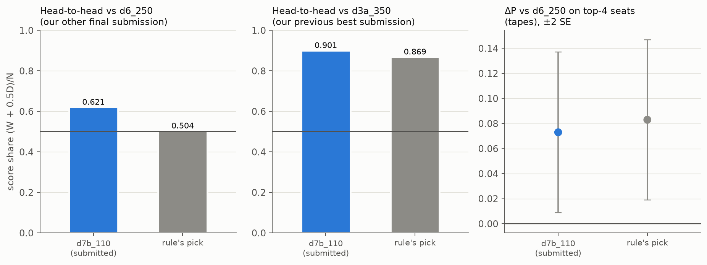
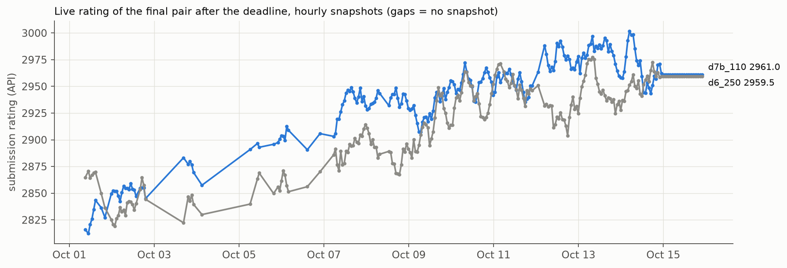

# Evaluation and checkpoint selection

## 1. Principles

- **Paired.** A candidate and a reference play the same seeds, in both seats. The shop schedule depends on both farms
  (one shared random generator), so unpaired comparisons are dominated by schedule luck (±10–28k in bank).
- **Standard error per seed.** The two seats of one seed gave the same outcome in 98–99% of seeds. Counting seats as
  independent understates the standard error by about 1.37×, so the mean of the two seats of a seed is one sample.
- **Win/loss, not money.** The final metric is a Bradley–Terry fit over game outcomes. Banks and margins are reported,
  but decisions use P(win) = (W + ½D) / N, mostly in head-to-head games.
- **Gates written down before evaluation.** Each line had a preregistration file with the gates and the selection
  rule, written before the candidates were evaluated.
- **Deterministic games.** kagsim is bit-exact with `kaggle-environments` 1.32.7 and the exported agent is greedy, so
  an evaluation repeats exactly (`entry_points/evaluate.py`) on our x86-64 servers with the pinned NumPy. Other CPU
  architectures were not checked (a different BLAS could flip a near-tie argmax).

## 2. Evaluation sets

| Set | Content | What it is good for | Caveat |
|---|---|---|---|
| LB field | 10,454 recorded seats of 3,056 teams below the top 50 (tape opponents) | catching rare losses to weak and mid-table play | tapes do not react; absolute P is inflated |
| Top-team tapes | seats of the current top teams from the newest games (the "top-team tape check" of the gates) | paired differences between candidates | inflated; overlaps the BC data and the league pools |
| Code opponents | our earlier agents and public notebooks, both seats | reactive opponents | some of them were in the training league |
| Head-to-head | candidate vs our previous best, 512 seeds × 2 seats | the closest proxy for the final metric | inflated when the reference's snapshots were in the candidate's league |
| Random / pass | the engine's random agent; an empty farm | sanity, latency, laziness | — |

The LB field and the top-team tapes are other teams' recorded games and are not in this repository, not even as
manifests (only the six training pools are, [data/README.md](../data/README.md)). So gate G1 and the top-team tape
check cannot be reproduced from here. What can be rerun: the head-to-head between the two final submissions
(`entry_points/evaluate.py`, below) and games against the random agent and the empty farm (`entry_points/predict.py`).

## 3. Gates of the final checkpoint

All games on kagsim, NumPy fp16, greedy.

| Gate | Rule | `d7b_110` |
|---|---|---|
| G1, leaderboard field | ≤ 3 non-wins over the 10,454 LB-field seats | 0 |
| G2, critic | 128/128 wins against random, no game < 1k bank, all games finish; latency ≤ 150 ms mean, ≤ 400 ms max; torch/NumPy agreement ≥ 2,860/2,876 | passed (candidates: min bank 56–68k, 87–92 ms per turn) |
| G3, head-to-head | against the previous best submission `d3a_350` ≥ 0.5 + 2 SE | 0.901 (512 seeds × 2 seats from 98,300,000; SE per seed) |
| Top-team tape check | ΔP against `d6_250` on the top-team tapes not worse than −2 SE | +0.005 (SE ≈ 0.008) |



*Protocol of the figure.* `d7b_110` (submitted) and the snapshot picked by the preregistered rule. Head-to-head:
kagsim, NumPy fp16 greedy, seeds 98,300,000 … +511, both seats, SE per seed ≈ 0.02. Top-4 panel: ΔP against
`d6_250` on 206 seats of the top-4 teams from the top-team tapes, tape opponent, SE clustered by episode, bars ±2 SE.

**One manual override.** Several snapshots of the final line passed all gates. The preregistered rule preferred
the earliest snapshot whose ΔP against `d6_250` on the top-team tapes was within 2 SE of the best and that passed
the gates. It picked a different snapshot from `d7b_110`, shown as "rule's pick" in the figure. Head-to-head against our other final submission `d6_250` the rule's pick scored 0.504
and `d7b_110` 0.621; against `d3a_350` they scored 0.869 and 0.901; on the top-4 tape seats they differed by less
than 1 SE. Submitting `d7b_110` was a deliberate, manual deviation from the preregistration. Biases: head-to-head
against `d6_250` is inflated in d7's favour because d6 snapshots were opponents in the d7 league; the bias can grow
with training time, and `d7b_110` is not the earliest of the candidates, so part of its lead over the rule's pick may
be this bias. The tape sets partly overlap the BC data, and tapes inflate absolute P.

**Reproduce the reference number exactly:**

```bash
python entry_points/evaluate.py --a submission/rl_d7b_110.tar.gz --b submission/rl_d6_250.tar.gz \
    --seeds 512 --seed0 98300000
```

Expected: P = 0.6211, SE per seed 0.0201, mean bank 100,943, mean margin +470. On Oct 12 all 1,024 games of a rerun on
a clean copy were identical to the original evaluation, both banks to the dollar. This held on our x86-64 servers with
the pinned NumPy; other CPU architectures were not checked (a different BLAS could flip a near-tie argmax). The
command is expensive (at least ~2 core-minutes per game); see the cost in
[README.md](../README.md#reproduce-the-selection-number).

## 4. Live results

**Games after the deadline** (Kaggle API, episodes created between the deadline, Sep 30, 23:59 UTC, and our API
snapshot on Oct 8; outcome from the final rewards; binomial SE assuming independent games; the two submissions met
different opponents, so the rows are not a paired comparison):

| | W / D / L | P ± SE | vs top-10 | vs top-5 |
|---|---|---|---|---|
| `d7b_110` | 244 / 0 / 193 | 0.558 ± 0.024 | 0.455 ± 0.029 (303 games) | 0.390 ± 0.041 (141) |
| `d6_250` | 228 / 1 / 201 | 0.531 ± 0.024 | 0.409 ± 0.032 (243) | 0.242 ± 0.044 (95) |

**By opponent rank, up to Oct 14** (all public games returned by the API on Oct 14, at most the latest 1,000 per
submission; ranks from the leaderboard taken right after the games):

| Opponent (leaderboard rank) | `d6_250`: W-D-L (P) | `d7b_110`: W-D-L (P) |
|---|---|---|
| #1–7 | 135-1-250 (0.351) | 211-0-318 (0.399) |
| #9–30 | 372-0-183 (0.670) | 286-0-105 (0.731) |
| #31 and below | 57-0-2 | 44-0-0 |



*Protocol of the figure.* `public_score` of each submission from hourly snapshots of the Kaggle API (UTC), from the
first snapshot after the deadline to Oct 15 ([logs/live_ratings.csv](../logs/live_ratings.csv)); gaps are hours
without a snapshot. The ratings stopped changing on Oct 15: d7b_110 2961.0, d6_250 2959.5.

**Leaderboard.** Final ranking (one Bradley–Terry fit over the games of the active submissions after the
post-deadline period; Kaggle API, Oct 16, 2026, 18:24 UTC): team rank **8 of 10,148**, score 5395.7. Neighbours:
#7 5459.9, #9 5338.7. The final scale differs from the live ratings; the last live team score (Oct 15) was 2961.0.

## 5. What we learned about evaluation

- **A gate on money rejected a stronger snapshot.** An early gate "bank against weak opponents no lower than the base"
  rejected a later EMA snapshot that was stronger in head-to-head games and later live. For a win/loss metric, select
  by head-to-head games: neither money nor validation loss is a reliable proxy.
- **Tapes are for paired differences only.** A checkpoint that scored 0.60 against the top-4 on tapes won 0 of 14 live
  games against the top 5.
- **The leaderboard is path-dependent.** The same code got very different converged ratings depending on its early
  games; we judged submissions only after their rating had converged, and compared two of our submissions on the
  opponents they had in common.
