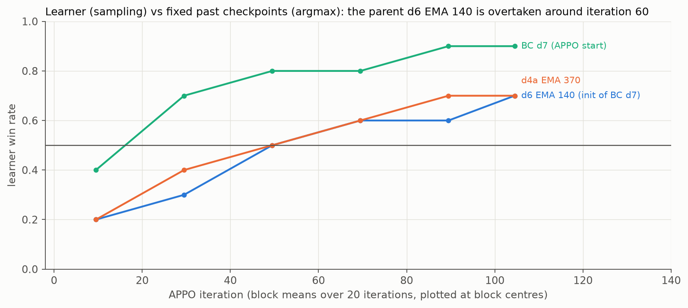

# Lessons: what mattered, what did not

Rows come from different leaderboard epochs and engine versions; "training games" are APPO games (the learner
samples, PFSP shifts the mix) and are not an evaluation.

## What mattered most

### 1. Learn the economy from the current top teams, almost daily

Switching the BC teacher from our code bot c3bc (our modification of a public notebook,
[agents/README.md](../agents/README.md#not-released)) to top-team games (line d1) changed everything:

- Non-wins on the 10,454-seat leaderboard field fell from 2.28% to 0.01%.
- Our bank on top-team seats matched their recorded banks (median 111.5k against 111.3k).

*Protocol:* NumPy fp16 greedy on kagsim, paired against the previous line's reference checkpoint on the same seats;
329 top-team seats against opponents ranked below 50. This is not a clean ablation: the RL recipe changed together
with the teacher.

The top meta changed almost every day (for example, a "fast opening" with the 3rd land quadrant before day 9 went
from 29% to 84% of top-10 games over Sep 26–27). After d1 we re-did BC on the newest top games almost daily, each time
starting from a recent RL model of ours; this kept the policy on the moving meta.

### 2. BC → RL, not BC alone

- **BC alone collapses in closed loop.** In August an end-to-end BC with 0.955 top-1 action accuracy could not start
  a farm (bank 20–670 against ~140k for the expert). A hierarchical BC with 87% target agreement destroyed an already
  built farm within 5 game days.
- **Re-cloning first makes the model weaker.** In the final line the learner beat its RL parent in only about 20% of
  games over the first 20 APPO iterations, drew level around iterations 40–59, and won about 0.6–0.7 of the games
  after that (training games, [logs/appo_d7b_vs_fixed_past.csv](../logs/appo_d7b_vs_fixed_past.csv)). A member of
  the team M & M & P & Q reported the same dip after a second BC in the competition forum (topic 745073).

### 3. Laziness

With an outcome reward, the policy only needs to beat the opponent in front of it. In line d1 (run d1b) we ran an
entropy bonus of 1e-3 and let the KL weight decay to 0.002. Between iterations 60 and 420 (training games, sampled
actions):

| Measure | Iteration 60 | Iteration 420 |
|---|---|---|
| Bank against our code agent | 104.9k | 96.7k |
| Bank against an opponent that does nothing | 152.6k | 11.8k |
| Entropy | 0.16 | 0.56 |

The policy stopped investing whenever investing was not needed to win, and snapshots after about iteration 200 started
losing on our test sets. A reward for our own bank (+0.25 · clip(bank / 100,000, 0, 2)) did not bring investing back:
we added it to an already lazy model of an earlier line (r2, not d1b), and against the idle opponent its bank went
from 24k to 10k by iteration 136 of that run (training games).

**Fix (from line d2 on):** entropy bonus 0 and a KL floor of 0.005. The ratchet anchor (KL to the last version that
provably beat its predecessor) is a separate stabiliser: d1b already used it, so it alone does not prevent laziness.
With the fix, laziness still returned later (in line d2 after about 150 iterations entropy rose again and our bank
fell, also against an idle opponent), so we prefer early EMA snapshots.

### 4. A rule belongs in the training environment

Forcing the 4th land quadrant on top of a trained network destroyed its farm: P(win) 0.00–0.37 against 1.000 on a
held-out set of 20 code opponents. The same purchase applied as an environment event during training worked; both
final submissions come from lines trained with this rule. Details: [method.md](method.md#8-the-4th-quadrant-rule).

### 5. Exact replays are worth the effort

Because kagsim reproduces recorded games to the dollar, one recorded game serves as a demonstration, an opponent and a
test case. The engine-level parity work (kagsim → our C++ encoder → our CUDA engine, checked bit for bit) is what made
the near-daily BC → APPO loop easy to trust.

## What did not work

| Idea | Outcome |
|---|---|
| Replaying a recorded top game + hand-written rule layers (August) | about 2830 after convergence in a 3.6k-team field, then a steady drift down; a frozen record does not react to the market and crashes its own prices |
| Hand-written reactive controller | 991 on the leaderboard |
| Pure BC (end-to-end, hierarchical) | the farm never starts or collapses in closed loop |
| RL from BC of our code bot c3bc (lines r1/r2) | inherited a weak build-up; live rating stuck at 1440–1680 |
| Reward for own bank (+0.25 · clip(bank / 100,000, 0, 2)), added to an already lazy model of an earlier line | bank against an empty opponent 24k → 10k (training games) |
| KL to a top-team BC model on the build heads only | win rate against the field collapsed 0.98 → 0.03 within one iteration (training games) |
| A separate endgame network switching in at turn 432 | worse margin in every variant (−0.7k to −14.5k) |
| A "bank not below the base" gate | rejected a stronger later snapshot; for win/loss, head-to-head decides |
| Buying the 4th quadrant at inference only | P(win) 0.00–0.37 against 1.000 on held-out code opponents |

## Limitations

- **No ablations.** We never measured the separate contributions of the privileged critic, UPGO, PFSP, EMA, the land
  rule or each BC dataset. Data, initialisation and recipe changed together between lines.
- **Units decide independently given the state.** Two units can pick the same tile.
- **Endgame.** Some opponents hoard goods and dump them in the last steps. We lost one live game by 663 after leading
  by 17.2k eight steps before the end.
- **Tapes do not react.** Absolute numbers on tape sets are optimistic; only paired differences are reliable.
