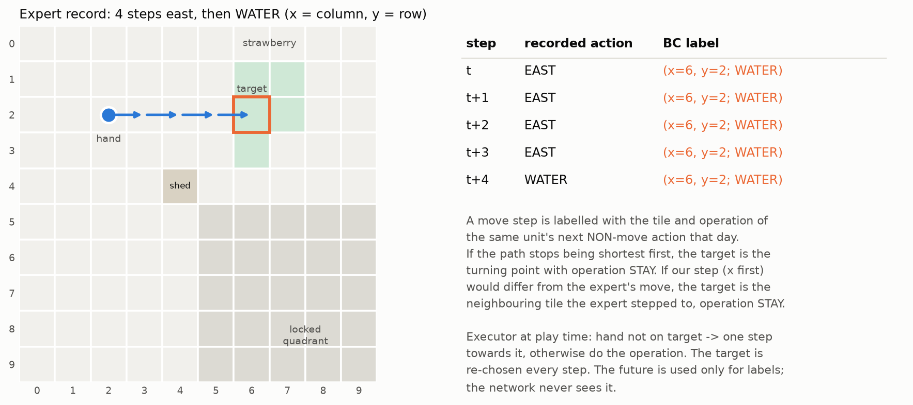
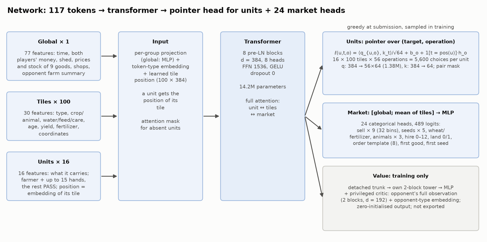
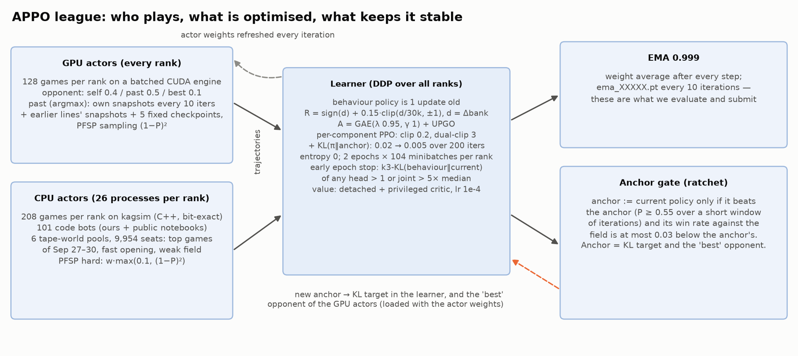
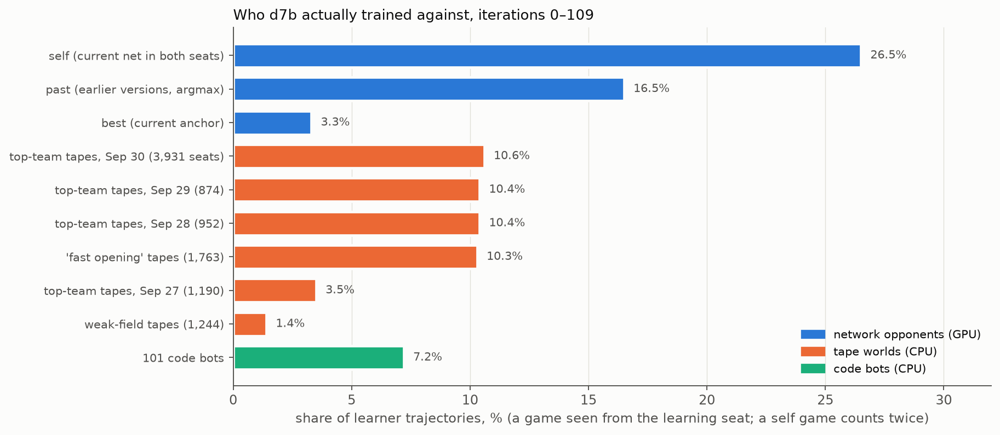
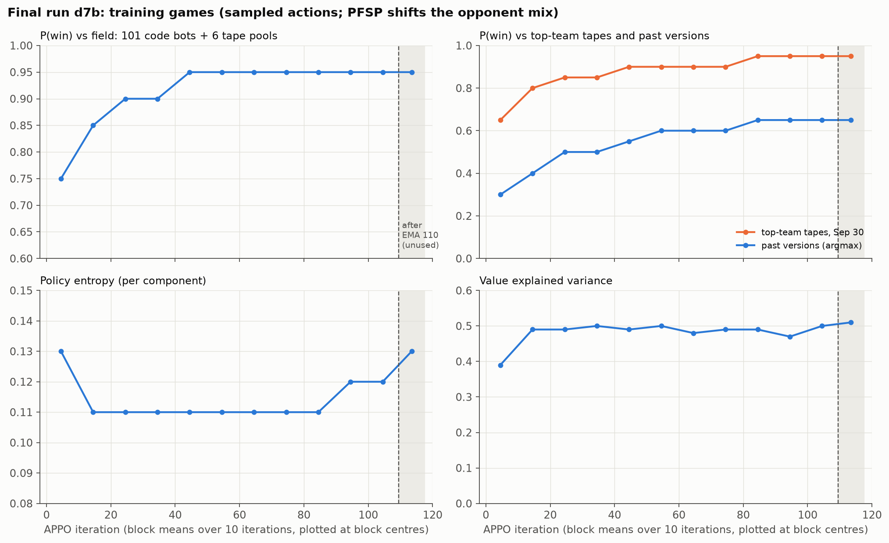
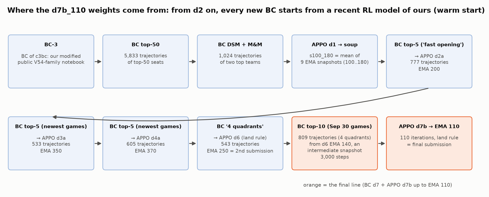

# Method

Every number in this document comes with the protocol it was measured under. "Training games" means games played
during APPO: the learning side samples its actions and PFSP shifts the opponent mix, so they are not an evaluation.

## 1. What in the game shaped the design

- **Length and goal.** 720 turns (30 days × 24). The larger bank at the end wins; unsold inventory is worth nothing.
  The final ranking is a Bradley–Terry fit over game outcomes, so the training target is P(win), not money.
- **A turn** is one farmer action, one action per hired hand, and up to 10 market orders. Illegal actions silently
  become no-ops.
- **Interaction.** Players interact only through the shared market. Sales push prices down; the town and the shops
  push them back up. Premium goods (milk, wool, strawberry, melon) lose value sharply when overproduced.
- **Randomness.** The only randomness (weeds, shop order) comes from one generator shared by both farms. A policy that
  changes the number of empty tiles changes the whole shop schedule, which moves the bank by ±10–28k. All our
  comparisons are therefore paired on the same worlds.
- **Time limit.** 1 s per turn plus a 60 s reserve per game. This set the network size and the NumPy inference.

## 2. Observation: 117 tokens, no memory

Encoded once per turn by `rl/encode.py`. The C++ (`engines/kagcore`) and CUDA (`engines/kagrl_cuda`) versions are
checked against it bit for bit ([code_map.md](code_map.md#engine-parity)).

| Token | Count | Features | Content |
|---|---:|---:|---|
| global | 1 | 77 | time, both players' money, own shed, price and town stock of 9 goods, open shops, both players' land quadrants, a summary of the opponent's farm |
| tile | 100 | 30 | our own farm |
| unit | 16 | 16 | farmer and hands; a unit token gets the positional embedding of its tile |

There is no history: every decision is made from the current state only.

## 3. Action: what the network decides and what is computed

**Units.**
- Per unit, a joint softmax over 100 tiles × 56 operations (5,600 choices), masked to legal pairs.
- The executor (`rl/act.py`): if the unit is not on its target, it takes one step towards it, x first; otherwise it
  performs the operation. The target is re-chosen every turn.
- The 56 operations:
  - farm: STAY, plant × 5 crops, WATER, HARVEST, FERTILIZE, BUILD_COOP, BUILD_PASTURE, FEED, COLLECT_FERTILIZER, CARE,
    DIG;
  - shed: DROP; PICKUP of wheat 1–10, fertilizer 1–8, animals 3 kinds × 1–3;
  - placement: PLACE animal × 3, PLACE whole stack of a good × 9, PLACE_WHEAT_1.

**Market: 24 heads, 489 logits.**
- sell each of 9 goods: 0–24, 28, 32, 36, 40, 48, 64, or "everything in the shed";
- 5 seed heads: 0–12, 16, 20, 24, 32;
- buy wheat / fertilizer: 0–24, 32, 48, 64;
- 3 animal heads: 0–6; hire: 0–12; land: 0–1;
- an **order template**: 8 orderings of the six order groups (S sells, P product purchases, D seeds, A animals,
  H hire, L land; `rl/spec.py`), plus the first item within the sell and seed groups.

The executor applies the units' actions to a projection of the shed first ("everything in the shed" means after
them). Then it emits the orders in template order and truncates to 10. Order matters: sales fund land and hiring, and
the 10-order cap binds.

**Hindsight labels for BC** (`rl/act.py`).
- A recorded expert move step is labelled with the tile and operation of the same unit's **next non-move action that
  day**.
- If our x-first path would differ from the expert's move, the label is the turning point (or the neighbouring tile
  the expert stepped to) with operation STAY.
- The future is used only to build labels; the network never sees it. BC learns intentions instead of walking
  choreography.

## 4. Network

`rl/model.py`; NumPy port `rl/np_net.py`.

| Part | Design |
|---|---|
| Trunk | 8 pre-LayerNorm transformer blocks, d = 384, 8 heads, FFN 1536, GELU, no dropout |
| Unit head | ℓ(u, t, o) = ⟨q_{u,o}, k_t⟩/√64 + b_o + 1[t = pos(u)]·h_o: a pointer over tiles per operation |
| Market head | MLP over [global token; mean of tile tokens] → 24 independent categorical heads |
| Value (training only) | the trunk output is detached; a separate 2-block tower. A privileged critic additionally encodes the opponent's full observation (2 blocks, d = 192) and an opponent-type embedding; its output layer is zero-initialised, so adding it does not shift a trained value |
| Submission | 16,320,409 actor parameters; fp16 storage, fp32 compute, one thread, argmax. Torch vs NumPy greedy actions agree in at least 2,860 of 2,876 control steps (differences come from fp16 rounding) |

## 5. Tape worlds

A **tape world** is a recorded game: seed, shop order, and both seats' actions ([data/README.md](../data/README.md)).
We replay it in kagsim and accept it only if both final banks match the record to the dollar. It is used three ways:

| Use | How | Caveat |
|---|---|---|
| BC demonstrations (`rl/gen_bc_tapes.py`) | the observation before each turn + the hindsight labels of a teacher seat | only seats of the selected teams; games with our team excluded |
| League opponent (`rl/appo.py`, league entry `tapes:<pool>`) | our policy takes one seat; the other seat replays its recorded actions | a tape does not react to our market behaviour |
| Evaluation | paired differences between two of our agents on the same worlds | absolute P(win) on tapes is inflated |

**Why absolute win rates on tapes are inflated.** When we play differently from the original opponent, some recorded
orders no longer fill, and the tape's bank drops to 0.94–0.98 of the record. One of our checkpoints (`d3a_350`)
scored 0.60 against the top-4 on tapes and won 0 of 14 live games against the top 5.

## 6. Behaviour cloning (final line d7)

`rl/gen_bc_tapes.py`, `rl/bc_train.py`, `configs/bcgen_d7.json`, `configs/bc_d7.json`.

| | |
|---|---|
| Data | 809 trajectories (seat × episode) from 2,049 reproduced Sep 30 games |
| Teachers | the leaderboard top-10 on Sep 30: DECEM 211, DSM 200, M & M & P & Q 127, Majkel1337 112, Victor @ Tufa Labs 97, CDE 41, Vadim Vasilenko 16, Unknown Mother-Goose 5 |
| Seat filter | 4 land quadrants by turn 300; every game involving our team excluded |
| Initialisation | the actor of `d6` EMA 140 (value towers dropped), an intermediate snapshot of the previous line d6. It was not submitted: it did not pass gate G2 ([evaluation.md](evaluation.md#3-gates-of-the-final-checkpoint)) because of one 0 : 0 game against the random agent |
| Loss | cross-entropy over the (target, operation) pair + cross-entropy over the market heads + 0.25 × value MSE to the teacher's game outcome |
| Optimisation | AdamW, lr 1e-4 with warm-up then decay to 0, weight decay 0.01, betas (0.9, 0.98); 3,000 steps × 2,048 states ≈ 10 passes over ~0.58M states |
| Validation | held-out shards (index divisible by 50: 16 of 809 trajectories; the first 20 per-GPU batches of the validation stream). At step 3,000: unit pair accuracy **0.90**, operation 0.93, market 0.97, non-zero market decisions 0.76; training accuracies over steps 2,001–3,000: 0.94 / 0.95 / 0.97 / 0.70 ([logs/bc_d7_train.jsonl](../logs/bc_d7_train.jsonl)). The two seats of one game can fall into different shards, so some leakage is possible |

**BC accuracy is not playing strength.**
- In August, an end-to-end BC with 0.955 top-1 action accuracy could not start a farm in closed-loop play: bank 20–670,
  against ~140k for the expert.
- A hierarchical BC with 87% target agreement destroyed an already built farm within 5 game days. The expert never
  shows how to recover from a degraded state.

BC is our starting point and our anchor. RL teaches the policy to play from its own states.

## 7. APPO league (final run d7b)

`rl/appo.py`, `configs/appo_d7b.json`, `configs/league_d7.json`.

**Layout.** Data-parallel ranks; each rank is 1 GPU + 26 CPU worker processes.
- The GPU holds the learner (DDP) and a batched CUDA engine running 128 network-vs-network games.
- The CPU workers play 208 games on kagsim against code bots and tapes.
- Collection and updates overlap; data lags the learner by one version (no V-trace).
- Each iteration: 2 epochs × 104 minibatches per rank.

**Opponents.**

| Source | Sampling | Purpose |
|---|---|---|
| self | GPU, weight 0.4 | a reactive opponent at our own level |
| past | GPU, weight 0.5, argmax play: own snapshots every 10 iterations + snapshot pools of three earlier lines d1, d4, d6 (0.3/0.3/0.4) + 5 fixed checkpoints (BC d7, d6 EMA 140, d4a EMA 370, soup s100_180, d1b 150); PFSP (1 − P)², floor 0.02 | keep beating old strategies; an argmax opponent does not teach us to exploit its random mistakes |
| best | GPU, weight 0.1, the current anchor | statistics for the anchor gate |
| 101 code bots | CPU, PFSP "hard": w · max(0.1, (1 − P)²) | our earlier agents and public notebooks: diverse reactive economies |
| 6 tape-world pools, 9,954 seats | CPU, pool weight × PFSP | the top meta of Sep 27–30 (3,931 seats from Sep 30), the "fast opening", a weak field |

**Objective and regularisation.**

| Component | Value | Why |
|---|---|---|
| Reward | R = sign(d) + 0.15 · clip(d / 30,000, −1, 1), d = bank difference at the end | the metric is the outcome; the margin term separates close wins from safe ones |
| Advantage | GAE (λ 0.95, γ 1) + UPGO weight 1.0; value target = full return | sparse terminal reward |
| PPO | a separate probability ratio per component (each unit's pair, each market head); clip 0.2; dual-clip 3 | one joint ratio over 16 units and 24 heads is too noisy |
| KL to the anchor | coefficient 0.02 → 0.005 over 200 iterations, then a floor of 0.005 | without a floor the policy drifts ("laziness", [lessons.md](lessons.md#3-laziness)) |
| Entropy bonus | 0 | a 1e-3 bonus with a weak KL caused laziness |
| Early epoch stop | k3-KL(behaviour ‖ current) of any head > 1, or the joint value > 5 × the median of the last 10 | protection against outliers under asynchrony |
| Anchor gate | anchor := current policy if, over a short window of iterations and a minimum number of games (`--anchor-window`, `--anchor-min-games`), it scored P ≥ 0.55 against the anchor and its win rate against the field is at most 0.03 below the anchor's | KL pulls towards the last *provably better* version (a ratchet), not towards BC forever |
| Weight EMA | 0.999 after every optimizer step; `ema_*.pt` every 10 iterations | we evaluate and submit EMA weights |
| Optimizer | AdamW; actor lr 2e-5, value lr 1e-4; value warm-up 5 iterations, lr warm-up 256 steps; gradient clip 1 | — |
| 4th land quadrant | on turns 248–319, if exactly 3 quadrants are open and money ≥ 4,000, the executed market action gets land = buy and the order template SLPHDA (sales first, then land); the other orders stay | section 8 |

**Course of d7b** (training games; means over blocks of 10 iterations). P(win) against the field (101 bots + tapes)
rose from 0.75 (iterations 0–9) to 0.95 (from iteration 40 on), and against the Sep 30 top tapes from 0.65 to 0.95
(iterations 100–109). Entropy fell from 0.13 to 0.11, stayed there up to iteration 89, then rose to 0.12
(iterations 90–109) and 0.13 (110–117): one reason to prefer early EMA snapshots. The parent `d6` EMA 140 was overtaken
around iteration 60. Curves: [logs/appo_d7b_curves.csv](../logs/appo_d7b_curves.csv).

## 8. The 4th-quadrant rule

The top teams opened the 4th land quadrant by about day 11. Our network bought it unreliably: in 88% of games after
BC d6, and in 55% after 30 RL iterations.

- **At inference only, it failed.** Forcing the purchase on top of a trained RL model dropped P(win) on a held-out set
  of 20 code opponents from 1.000 to 0.00–0.37. The network had never learned what to do with a 4th quadrant, and the
  farm fell apart.
- **As an environment event during training, it worked.** On turns 248–319, if exactly 3 quadrants are open and
  money ≥ 4,000, the environment edits the executed market action (`--land-inject 248 --land-window 72`): the land
  head is set to "buy" and the order template to SLPHDA (sales first, then land); the other orders stay. The stored
  action and its log-probability remain the network's own, so the network still trains on its own land choice, but
  every game continues with 4 quadrants and the rest of the policy learns to farm them. The submission applies the
  same rule (`--land-inject 248:72` at export).

Both final submissions come from lines trained this way. We did not run an equal-budget comparison with and without
the rule.

## 9. Lineage of the weights

From d1 on, each line = BC on the newest top-team games, then APPO. From d2 on, this BC starts from a recent RL model
of ours (usually our best model at the time; for d7 an intermediate d6 snapshot). The BC of d1 started from an earlier
BC model, and the r-lines cloned our code bot c3bc (a modified public notebook, below).

| Line | What changed | Submission rating (API) |
|---|---|---|
| r1/r2 | BC of our code bot c3bc (our modification of a public V54-family notebook with CEM-tuned constants; [agents/README.md](../agents/README.md#not-released)) → PPO → APPO with a league of 101 bots | 1440–1680 |
| d1 | teacher switched to the top teams: BC of DSM + M & M & P & Q → APPO; laziness found here (run d1b) | 2900 / 2903 |
| s100_180 | weight average of 9 EMA snapshots of d1 (100…180) | 2877 |
| d2 | BC of top-5 "fast opening" games (777 trajectories) from s100_180 → APPO with entropy bonus 0 and a KL floor of 0.005 (the laziness fix) | 2839 / 2905 |
| d3 | BC of newer top-5 games (533 trajectories) from `d2a200` → APPO | 2844 |
| d6 | BC of top seats with 4 quadrants (543 trajectories) from `d4a_370` + the 4th-quadrant rule → APPO | 2959.5 (Oct 15) |
| **d7** | BC of top-10 games of Sep 30 (809 trajectories) from an intermediate `d6` snapshot (EMA 140) → APPO | **2961.0 (Oct 15)** |

*Protocol.* Rating = the submission's `public_score` from hourly API snapshots: the peak while the submission was
active, or the final value on Oct 15 (the ratings stopped changing that day). The leaderboard field changed from day to day, so comparisons between lines in this table
are qualitative; decisions were made with paired offline tests ([evaluation.md](evaluation.md)).

**Ensembling.** None at inference: each submission is a single network. Weight averaging appears only in the lineage:
`s100_180`, an equal average of 9 EMA snapshots, is one of the fixed past opponents and an ancestor of the final
weights.

## 10. Inference

- `rl/export_agent.py` turns a checkpoint into `main.py` + `weights.npz` + a package `rl_<sha8>/` with the encoder,
  executor and NumPy network. `weights.npz` holds 124 arrays: 122 float16 (16,320,409 actor parameters plus a
  value-head MLP that inference does not use) and 2 int64 metadata arrays.
- One game = 719 agent calls. Offline: 87–92 ms per call on average for the final candidates (NumPy, fp16 weights, one
  thread of an x86-64 server CPU, all 719 calls of a game).
- On Kaggle's servers the same-size network was slower. For an earlier submission of the same architecture and export,
  Kaggle's agent logs showed 278 ms mean and 802 ms max per turn over its first 18 games. This is within
  the limit: the 60 s reserve is spent only by turns longer than 1 s.

## References

| Technique | Our use | Source |
|---|---|---|
| Fast bit-exact simulator | kagsim for CPU games; our CUDA port for batched network-vs-network games | destbreso/kaggriculture-cppsim (Apache-2.0), based on nikital7's C++ port; Lux AI S3, Generals.io (arXiv 2606.23348) |
| Hindsight (target, operation) labels | BC labels | in spirit: Hindsight Experience Replay, arXiv 1707.01495 |
| Pointer head over tiles | per-unit target choice | Pointer Networks, arXiv 1506.03134; AlphaStar's pointer-based target selection |
| Factorised action, per-component PPO, dual-clip | 16 units + 24 heads | JueWu / Honor of Kings, arXiv 1912.09729 |
| BC → RL with KL to the teacher | initialisation and anchor | AlphaStar (Nature 2019); Kickstarting, arXiv 1803.03835; Lux AI S1 1st place |
| Ratchet anchor | replaced at P ≥ 0.55 | Orbit Wars 1st place (Tufa Labs write-up); Generals.io, arXiv 2507.06825; DeepNash, arXiv 2206.15378 |
| PFSP (1 − P)², past opponents play argmax | league sampling | AlphaStar; Generals.io, arXiv 2507.06825 |
| UPGO + GAE | advantage | AlphaStar; GAE, arXiv 1506.02438 |
| Early stop on k3-KL | per head + joint | "The 37 implementation details of PPO" (ICLR blog track 2022); J. Schulman, "Approximating KL divergence" |
| Detached value with its own tower, privileged critic | value training | PPG, arXiv 2009.04416; AlphaStar; asymmetric actor-critic, arXiv 1710.06542 |
| Asynchronous actor-learner, 1-version lag | APPO | Sample Factory, arXiv 2006.11751; IMPALA, arXiv 1802.01561; OpenAI Five, arXiv 1912.06680 |
| Weight EMA; weight soup | submissions; s100_180 | Generals.io, arXiv 2606.23348; Model soups, arXiv 2203.05482 |
| Outcome + bounded margin reward, γ = 1 | reward | Back Track King (CodinGame); Orbit Wars; Generals.io |
| Paired evaluation, per-seed SE, preregistered gates | checkpoint selection | standard statistics |
